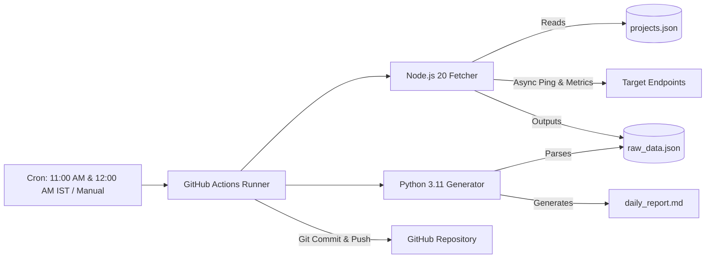

# 🛰️ Centralized Project Health Monitor

A lightweight, automated health monitoring system using a polyglot architecture (Node.js + Python) executed via GitHub Actions with **zero external dependencies**.

---

## 🏗️ Architecture



---

## 📁 Repository Structure

```text
.
├── .github/
│   └── workflows/
│       └── monitor.yml        # GitHub Actions workflow (daily cron + workflow_dispatch)
├── projects.json              # Configuration list of target endpoints to monitor
├── fetcher.js                 # Node.js asynchronous HTTP health prober (native fetch)
├── generator.py               # Python data processing & Markdown report generator
├── raw_data.json              # Raw timestamped metrics & status data (auto-generated)
├── daily_report.md            # Polished Markdown status dashboard (auto-generated)
└── README.md                  # Project documentation & configuration guide
```

---

## 🛠️ Configuration Guide

### 1. Adding or Editing Projects (`projects.json`)

All targets to be monitored are declared inside `projects.json` as a JSON array of objects.

```json
[
  {
    "name": "CampusPulse",
    "type": "website",
    "url": "https://github.com/noaman024/campuspulse"
  },
  {
    "name": "MJ Assistant",
    "type": "repo",
    "url": "https://github.com/noaman024/mj-assistant"
  }
]
```

#### Supported Fields:
| Field | Type | Description | Examples |
| :--- | :--- | :--- | :--- |
| `name` | string | Display name of the project | `"CampusPulse"`, `"Auth API"` |
| `type` | string | Category tag (`website`, `api`, or `repo`) | `"website"`, `"api"`, `"repo"` |
| `url` | string | Any reachable HTTP/HTTPS URL | `"https://api.myproject.com/health"`, `"https://github.com/user/repo"` |

> [!TIP]
> **Monitoring Local or Headless Projects:**  
> If a project is hosted only locally (e.g. desktop apps, local scripts, internal tools), set `type` to `"repo"` and use its public GitHub repository URL (e.g., `https://github.com/noaman024/mj-assistant`). GitHub returns HTTP `200 OK` for existing repositories, allowing you to monitor repository availability and commit activity without a live public server.

---

### 2. Calculating and Changing the Cron Schedule

The GitHub Actions runner executes jobs on **UTC (Coordinated Universal Time)**.

In `.github/workflows/monitor.yml`, the schedule is defined using standard POSIX 5-field cron syntax:

```text
┌───────────── minute (0 - 59)
│ ┌───────────── hour (0 - 23, in UTC)
│ │ ┌───────────── day of the month (1 - 31)
│ │ │ ┌───────────── month (1 - 12)
│ │ │ │ ┌───────────── day of the week (0 - 6, Sunday to Saturday)
│ │ │ │ │
* * * * *
```

#### How to Convert Local Time (IST) to UTC Cron:

India Standard Time (IST) is **UTC + 5:30**. To run the workflow at your target IST time, subtract `5 hours and 30 minutes` from your target time:

$$\text{UTC Time} = \text{Target IST Time} - 5\text{ hours } 30\text{ minutes}$$

#### Step-by-Step Example (11:45 PM IST):
1. **Target IST:** `23:45` (11:45 PM)
2. **Subtract 5 hours 30 minutes:**  
   $23:45 - 05:30 = 18:15 \text{ UTC}$
3. **Map to Cron Syntax:**  
   - Minute = `15`  
   - Hour = `18`  
   - Cron Expression: `'15 18 * * *'`

#### Quick Reference Table:
| Desired IST Time | Calculated UTC Time | GitHub Actions Cron Expression |
| :--- | :--- | :--- |
| **11:45 PM IST** *(Current default)* | **18:15 UTC** | `'15 18 * * *'` |
| 11:30 PM IST | 18:00 UTC | `'0 18 * * *'` |
| 11:55 PM IST | 18:25 UTC | `'25 18 * * *'` |
| 09:00 AM IST | 03:30 UTC | `'30 3 * * *'` |
| 06:00 PM IST | 12:30 UTC | `'30 12 * * *'` |
| 12:00 AM Midnight IST | 18:30 UTC (prev. day) | `'30 18 * * *'` |

#### Updating the Schedule in Workflow:
Open `.github/workflows/monitor.yml` and modify line 6:

```yaml
on:
  schedule:
    # Runs twice daily: 05:30 UTC (11:00 AM IST) and 18:30 UTC (12:00 AM IST midnight)
    - cron: '30 5,18 * * *'
  workflow_dispatch:
```

---

## 🚀 Local Execution

### 1. Run the Node.js Fetcher
Requires Node.js 18+ (uses native `fetch`):
```bash
node fetcher.js
```
*Pings all targets and writes results into `raw_data.json`.*

### 2. Run the Python Report Generator
Requires Python 3.8+ (uses standard library only):
```bash
python generator.py
```
*Parses `raw_data.json` and compiles the Markdown dashboard in `daily_report.md`.*

---

## ⚙️ GitHub Actions Setup & Permissions

To allow GitHub Actions to commit and push the updated `daily_report.md` and `raw_data.json` back to your repo:

1. Push this repository to GitHub.
2. In your GitHub repository:
   - Go to **Settings** > **Actions** > **General**.
   - Scroll down to **Workflow permissions**.
   - Select **"Read and write permissions"**.
   - Check the box **"Allow GitHub Actions to create and approve pull requests"** (optional but recommended).
   - Click **Save**.
3. **Manual Trigger:** You can test or trigger the workflow at any time from the GitHub repository **Actions** tab by selecting **"Centralized Project Health Monitor"** and clicking **"Run workflow"**.
